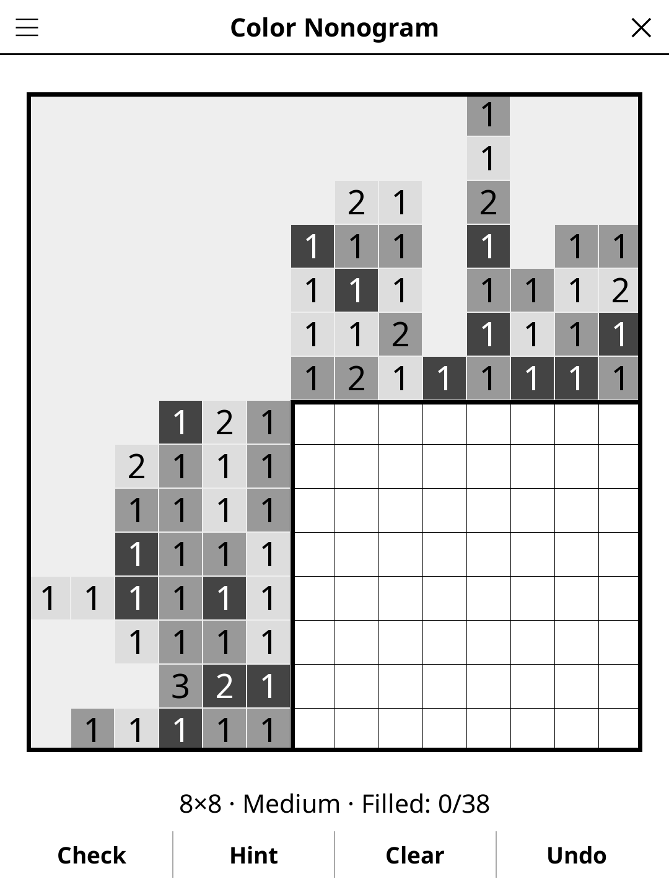

# colornonogram.koplugin

A Colour Nonogram (Colour Picross) puzzle plugin for [KOReader](https://github.com/koreader/koreader).

## Screenshot

## Rules

Like a Nonogram but cells are filled with colours. Each clue gives a colour and a run length. Different colours may be directly adjacent; same-colour runs must have at least one empty cell between them. Solve by deducing which colour (if any) belongs in each cell.

## Features

- **Two grid sizes** — 6×6 and 8×8
- **Three difficulty levels, no guessing** — every puzzle is solved by line
  logic alone (each row or column, from its clue and the cells already
  known), which also proves its solution unique. The levels differ by how
  long that chain of deductions is: *Easy* grids are full and settle in two
  or three sweeps, *Medium* takes four or five, *Hard* grids are emptier
  and take six or more.
- **Colour palette** — rendered as distinct patterns on greyscale e-ink
- **Check** — highlights incorrect cells
- **Hint** — two taps: the first says which cell is about to give, the second acts on it. A cell that contradicts the solution is always reported before a fresh one is revealed
- **Auto-save** — puzzle state saved and restored on next launch

## Installation

1. Download `colornonogram.koplugin.zip` from the [latest release](../../releases/latest).
2. Extract into the `plugins/` folder of your KOReader data directory.
3. Restart KOReader.
4. Open the menu → **Tools** → **Colour Nonogram**.

## Controls

| Action | How |
|--------|-----|
| Cycle cell colour | Tap cell (the cycle ends back on empty) |
| Check progress | Tap **Check** |
| New puzzle | Tap **New game** |
| Show rules | Tap **Rules** |

## License

GPL-3.0 — see [LICENSE](LICENSE).
